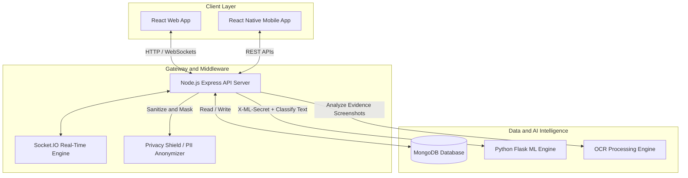
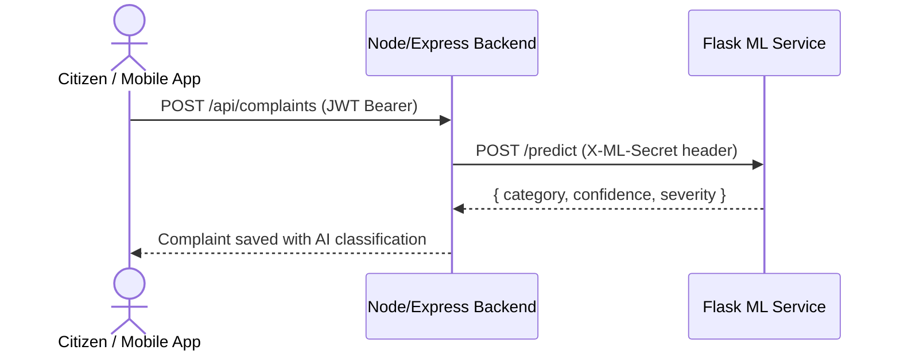
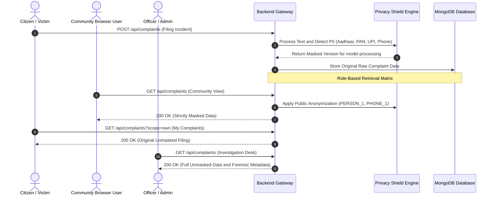
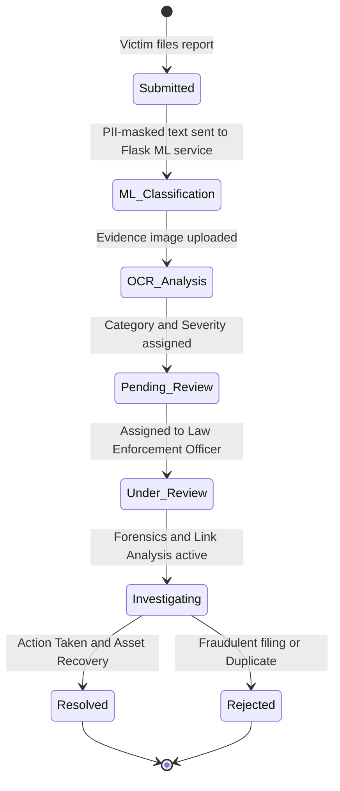

# CyberGuard AI — Cybercrime Reporting & Forensic Intelligence Platform

[](https://nodejs.org)
[](https://reactjs.org)
[](https://python.org)
[](https://github.com)
[](https://render.com)
[](#license)

---

## Product Demo

End-to-end walkthrough — incident intake → PII masking → ML classification → statutory case tracking.

[](docs/media/cyberguard-product-film.mp4)

*Watch the 15-second CyberGuard product walkthrough.*

---


## Live Deployment

| Service | URL |
| :--- | :--- |
| **Web App** | https://cybercrime-web-buzn.onrender.com |
| **Backend API** | https://cybercrime-backend-buzn.onrender.com/api |
| **ML Service** | https://cybercrime-ml-service-buzn.onrender.com/health |

> Render free-tier services spin down after inactivity. The first request after a cold start may take 15–30 seconds.

---

## Overview

CyberGuard AI is an AI-powered cybercrime complaint reporting, investigation, and threat intelligence platform. It follows a **zero-trust, role-based privacy architecture**: PII is automatically d[...]

**Onee**, the built-in interactive AI guide, walks citizens through the complaint form step by step — highlighting each field, validating input in real time, and offering a draft helper for incident[...]

---

## Key Features

- **AI Cybercrime Classification** — automated NLP categorization into 13 attack vectors: Financial Fraud, Phishing, Ransomware, Cyberbullying, Hacking, Identity Theft, Data Breach, Online Fraud, an[...]
- **Zero-Trust Role-Based Privacy Architecture**
  - **Complaint Owner** — full unmasked access to their own filing.
  - **Officer / Admin** — raw case data, forensic link-analysis graphs, and investigation tools.
  - **Community Browser** — PII automatically anonymized (`PERSON_1`, `PHONE_1`, `EMAIL_1`, `CITY_1`) for safe public browsing.
- **Onee Interactive Guide** — step-by-step citizen walkthrough with field spotlight, real-time validation, and AI draft helper for incident narratives.
- **OCR Evidence Intelligence** — extraction of bank accounts, UPI IDs, transaction hashes, and phone numbers from evidence screenshots.
- **Threat Heatmaps & Link Analysis** — geospatial attack maps and suspect relationship graphs.
- **Real-Time Communication** — Socket.IO powered notifications, status tracking, and encrypted chat channels.
- **Scam Search & Forensic Scanner** — cross-referencing suspect UPI IDs, phone numbers, and URLs against a verified threat database.
- **Internal ML Security** — server-to-server `X-ML-Secret` authentication between the Node backend and Flask ML service; rate-limited inference endpoints (30 req/min predict, 10 req/min batch).

---

## System Architecture

### 1. High-Level Platform Architecture



### 2. ML Request Flow

React and mobile clients **never call the ML service directly**. All classification goes through the Node/Express backend, which authenticates to the Flask ML service using a shared internal secret.



### 3. Multi-Tier Role-Based Privacy & Data Masking Flow



### 4. Complaint Lifecycle & AI Classification Engine



---

## Technology Stack

| Layer | Technologies |
| :--- | :--- |
| **Frontend Web** | React 18, Framer Motion, Recharts, Axios, Socket.IO Client |
| **Frontend Mobile** | React Native, Expo SDK 54, React Navigation, Axios, Expo Vector Icons |
| **Backend Core** | Node.js, Express.js, MongoDB, Mongoose, Socket.IO |
| **AI / ML Service** | Python 3.14, Flask, scikit-learn, TF-IDF + Multinomial Logistic Regression, Flask-Limiter |
| **Forensics & OCR** | Tesseract.js / Tesseract OCR, Sharp |
| **Security & Auth** | JWT, bcryptjs, Helmet, Express Rate Limit, PII Masking Shield, X-ML-Secret internal auth |
| **Deployment** | Render (web + backend + ML service), render.yaml infrastructure-as-code |

---

## Repository Structure

```text
CyberGuard_App/
├── backend/                   Node.js + Express REST API server
│   └── src/
│       ├── config/            Database and service connections
│       ├── controllers/       Complaint, Auth, Chat and Analytics logic
│       ├── middleware/        JWT auth, rate limiting, error handling
│       ├── models/            MongoDB schemas (Complaint, User, Chat, etc.)
│       ├── routes/            Express API route definitions
│       ├── services/          OCR, ML, Email and notification connectors
│       └── utils/             Privacy shield and PII masking utilities
│
├── ml-service/                Python Flask AI classification engine
│   ├── src/
│   │   ├── app.py             Flask API with rate limiting and internal auth
│   │   ├── classifier.py      CybercrimeClassifier (TF-IDF + Logistic Regression)
│   │   └── preprocessor.py    TextPreprocessor (regex, entity tokenization)
│   ├── models/                Pre-trained classifier and vectorizer .pkl files
│   ├── data/                  Training dataset (dataset.csv)
│   ├── train_model.py         Model training pipeline
│   ├── requirements.txt       Python dependencies
│   └── Procfile               Gunicorn startup command
│
├── web-app/                   React web application
│   └── src/
│       ├── components/        Navbar, Onee Guide, CyberReport, Scanner, Chat
│       ├── pages/             Dashboard, Community, Admin, Forensics, Settings
│       ├── services/           API Axios client and Socket listener
│       └── hooks/              Zustand auth and theme state management
│
├── mobile-app/                React Native (Expo SDK 54) mobile app (Threat Radar, Scam Search, Forensics)
│   ├── src/                   Native screens, components, services, and navigation
│   └── README.md              Mobile setup, troubleshooting, and QR code guide
│
├── docs/                      Product, user, and archival documentation
│   ├── user-guides/           CYBERGUARD_CITIZEN_USER_GUIDE.md
│   └── archive/               Historical audit and acceptance reports (14 archived reports)
│
└── render.yaml                Render infrastructure-as-code (3 services)
```

---

## Role-Based Access Matrix

| Feature / View | Citizen | Community Browser | Police Officer | Super Admin |
| :--- | :---: | :---: | :---: | :---: |
| File Complaint | ✓ | — | ✓ | ✓ |
| View Own Filings (Unmasked) | ✓ | — | ✓ | ✓ |
| Community Browse (Masked) | ✓ | ✓ | ✓ | ✓ |
| View Other's Raw PII | — | — | ✓ | ✓ |
| Command Center & Forensics | — | — | ✓ | ✓ |
| Status Update & Resolution | — | — | ✓ | ✓ |
| System User Management | — | — | — | ✓ |

---

## Quick Start — Local Development

### Prerequisites

- Node.js v18+
- Python 3.10+
- MongoDB v7.0+ (local or Atlas)

### Step 1 — Start MongoDB

**Windows:**
```powershell
Get-Service MongoDB
# If stopped:
net start MongoDB
```

**macOS:** `brew services start mongodb-community@7.0`
**Linux:** `sudo systemctl start mongod`

---

### Step 2 — ML Service (first time)

```powershell
cd CyberGuard_App\ml-service
py -3.10 -m venv .venv
.\.venv\Scripts\Activate.ps1
pip install -r requirements.txt
```

> Only run `python train_model.py` if the service reports the model is missing on startup.

---

### Step 3 — Backend (first time)

```powershell
cd CyberGuard_App\backend
npm install
```

Create `backend\.env` with at minimum:

```env
MONGODB_URI=mongodb://127.0.0.1:27017/cyberguard
JWT_SECRET=<random-secret>
JWT_REFRESH_SECRET=<random-secret>
ML_SERVICE_URL=http://127.0.0.1:5003
ML_INTERNAL_SECRET=<same-value-as-ml-service>
ALLOWED_ORIGINS=http://localhost:3000
```

---

### Step 4 — ML Service `.env` (first time)

Create `ml-service\.env`:

```env
ML_INTERNAL_SECRET=<same-value-as-backend>
ML_ALLOWED_ORIGINS=http://127.0.0.1:5002
```

> `ML_INTERNAL_SECRET` must be identical on both services. In production (Render), it is generated automatically on the backend and shared to the ML service via `fromService` in `render.yaml`.

---

### Step 5 — Web App (first time)

```powershell
cd CyberGuard_App\web-app
npm install
```

---

### Every-session Startup Order

```powershell
# Terminal 1 — ML Service (port 5003)
cd CyberGuard_App\ml-service
.\.venv\Scripts\Activate.ps1
python src\app.py

# Terminal 2 — Backend API (port 5002)
cd CyberGuard_App\backend
npm run dev

# Terminal 3 — React Web App (port 3000)
cd CyberGuard_App\web-app
npm start
```

> Use `npm start` for the web app, not `npm run dev`.

---

### Mobile App (React Native / Expo SDK 54)

The cross-platform mobile client connects to the backend API and provides mobile-native incident filing, threat radar, and forensic scanning.

```powershell
# Terminal 4 — Mobile App (Metro bundler port 8081/8082)
cd CyberGuard_App\mobile-app
npm install
npx expo start -c
```

- **iOS / iPhone:**
  - Standard LAN mode: Open Camera app and point to the QR code shown in your terminal (tap "Open in Expo Go").
  - Direct Safari deep-link: `exp://<YOUR_LOCAL_IP>:8081`
  - Cloud tunnel mode (across different subnets/cellular): `npx expo start --tunnel`
  - Overcoming account mismatch: In iPhone Expo Go, tap Profile → Sign Out to allow anonymous local dev.
- **Android:** Scan the terminal QR code directly from inside the Expo Go app.
- **Local Network API URL:** Set `EXPO_PUBLIC_API_URL=http://<YOUR_LOCAL_IP>:5002/api` in `mobile-app/.env`.
- For detailed mobile startup instructions, troubleshooting, and standalone build guides, see [mobile-app/README.md](file:///c:/Users/Mohith/CyberGuard_App/mobile-app/README.md).

---

## Deployment (Render)

All three services are defined in `render.yaml` and deploy automatically on push to `main`.

| Service | Type | Root | Start Command |
| :--- | :--- | :--- | :--- |
| `cybercrime-backend` | Node web | `backend/` | `npm start` |
| `cybercrime-ml-service` | Python web | `ml-service/` | `gunicorn -w 1 --threads 2 -b 0.0.0.0:$PORT src.app:app` |
| `cybercrime-web` | Static site | `web-app/` | `npm run build` |

### Required Render environment variables (set manually in dashboard)

| Service | Variable | Notes |
| :--- | :--- | :--- |
| backend | `MONGODB_URI` | Atlas connection string |
| backend | `ADMIN_PASSWORD` | Initial admin account password |
| backend | `GEMINI_API_KEY` | Google Gemini API key |
| backend | `ALLOWED_ORIGINS` | `https://cybercrime-web.onrender.com` |
| backend | `ML_INTERNAL_SECRET` | Auto-generated by Render (`generateValue: true`) |
| ml-service | `ML_ALLOWED_ORIGINS` | `https://cybercrime-backend.onrender.com` |
| ml-service | `ML_INTERNAL_SECRET` | Pulled automatically from backend via `fromService` |

---

## Default Dev & Demo Credentials

| Role | Email | Password | Access Scope |
| :--- | :--- | :--- | :--- |
| **Citizen (Demo)** | `citizen@test.com` | `Citizen@123` | File & track complaints, view public threat radar |
| **Police Officer** | `officer@cyberguard.gov` | `Officer@123` | Investigation desk, status updates, live triage radar |
| **Cyber Admin** | `admin@cyberguard.gov` | `Admin@12345` | Full administrative control, system logs & users |
| Root Admin | `admin@cybercrime.gov` | `Admin@123456` | Root database administrator |
| Staff Officer | `officer@cybercrime.gov` | `Officer@123456` | Secondary law enforcement profile |

> Change all default passwords immediately in any internet-facing environment.

---

## Main API Endpoints

| Method | Endpoint | Access | Description |
| :--- | :--- | :--- | :--- |
| POST | `/api/auth/register` | Public | Register new user account |
| POST | `/api/auth/login` | Public | Login — returns JWT access + refresh tokens |
| POST | `/api/auth/refresh` | Public | Refresh access token |
| POST | `/api/complaints` | Authenticated | Submit complaint with evidence |
| GET | `/api/complaints?scope=own` | Authenticated | Get own complaints (unmasked) |
| GET | `/api/complaints?scope=public` | Authenticated | Get all complaints (PII masked) |
| GET | `/api/complaints/:id` | Authenticated | Single complaint detail (role-masked) |
| PATCH | `/api/complaints/:id/status` | Officer / Admin | Update status and add timeline entry |
| GET | `/api/complaints/public/search` | Public | Search by phone, UPI ID, or account number |
| GET | `/health` | Public | Backend health check |

---

## Emergency Contacts (India)

| Helpline | Number |
| :--- | :--- |
| National Cybercrime Helpline (financial fraud golden hour) | **1930** |
| National Emergency (Police / Fire / Ambulance) | **112** |
| Women Cyber Distress Helpline | **1091** |
| National Childline | **1098** |

---

## License

Distributed under the MIT License.
